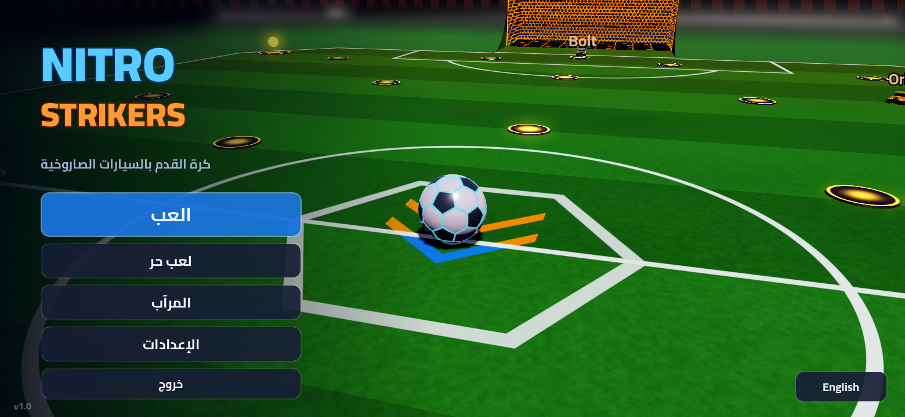
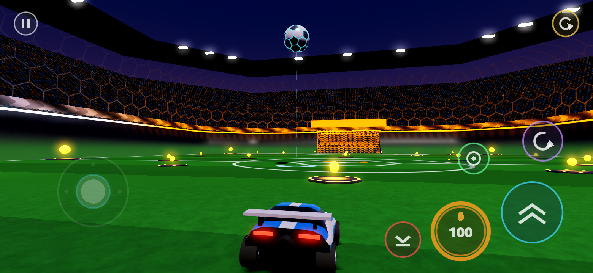
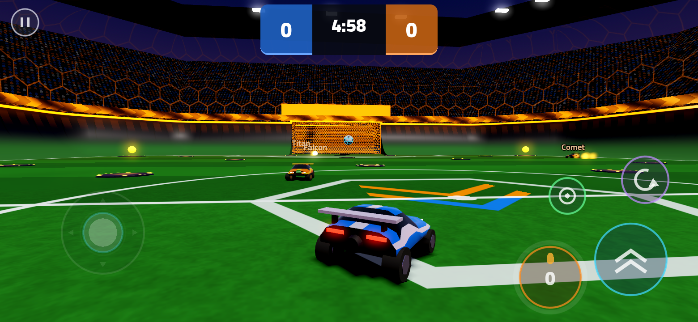
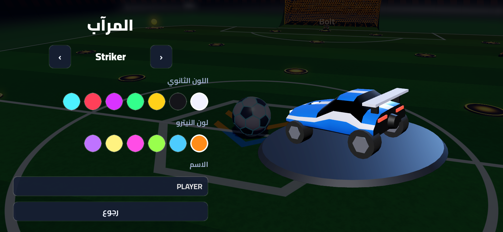
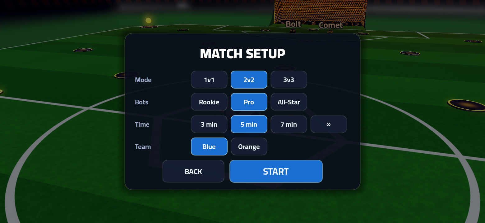
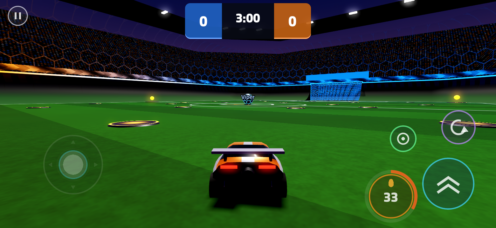
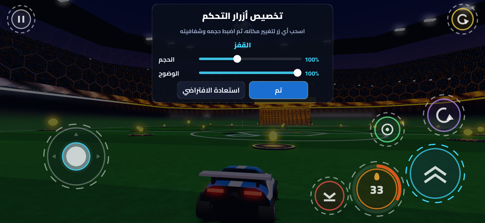

# NITRO STRIKERS — نيترو سترايكرز

لعبة كرة قدم بالسيارات الصاروخية للهواتف المحمولة، مبنية على محرك **Godot 4.4**.
ملعب بالحجم الكامل بجدران منحنية تستطيع القيادة عليها، كرة ضخمة، نيترو، قفز مزدوج، شقلبات، طيران جوي، تدمير الخصوم، إعادة الأهداف بالحركة البطيئة، وخصوم يتحكم بهم الذكاء الاصطناعي — مع تحكم لمسي مصمم خصيصًا للشاشات.

> لعبة أصلية من نوع "كرة القدم بالسيارات": الاسم والملعب وتصاميم السيارات والرسومات والأصوات كلها مصنوعة خصيصًا لهذا المشروع (إجرائيًا بالكود)، مع اعتماد أسلوب لعب وفيزياء ومقاسات ملعب مماثلة لما هو معروف في هذا النوع من الألعاب.




| | |
|---|---|
|  |  |
|  |  |
|  | |

---

## المميزات

**الفيزياء (محرك مخصص بتردد 120 هرتز)**
- تعليق بأربع عجلات (raycast) مع التصاق بالجدران والسقف، ومنحنيات انتقال سلسة بنصف قطر 6.4 م تحافظ على السرعة.
- منحنى تسارع، فرملة، انزلاق (Powerslide)، توجيه يعتمد على السرعة.
- قفزة بقوة متغيرة حسب مدة الضغط، قفزة مزدوجة، شقلبات أمامية/جانبية/خلفية مع إلغاء الشقلبة (flip cancel).
- تحكم جوي (pitch / yaw / roll) ودوران جوي (Air Roll).
- نيترو بسرعة قصوى 23 م/ث، حالة "فوق صوتية" (Supersonic) مع تدمير الخصوم عند الاصطدام.
- كرة نصف قطرها 0.92 م، ارتداد 0.6 مع دوران واحتكاك واقعي، ودفعة إضافية عند ضربها بالسيارة تمنح التسديدات قوة.

**الملعب (بالحجم الكامل)**
- طول 104 م (بين خطي المرمى) × عرض 82 م × ارتفاع 20.5 م، زوايا مشطوفة، مرمى بعرض 17.8 م وارتفاع 6.45 م وعمق 8.8 م.
- 6 وسائد نيترو كبيرة (100) و28 وسادة صغيرة (12) مع إعادة ظهور.
- نفس الهندسة تُستخدم للرسم والتصادم، ما يضمن تطابقًا تامًا.

**الرسومات**
- عشب بخطوط وعلامات متوهجة، جدران زجاجية سداسية، شاشات LED متحركة، مدرجات بجمهور متفاعل، أضواء ملعب، سماء غروب.
- 3 هياكل سيارات (Striker / Bulldog / Viper) بألوان قابلة للتخصيص، لهب نيترو، آثار فوق صوتية، انفجارات أهداف وتدمير، اهتزاز الكاميرا.
- 3 مستويات جودة (منخفضة/متوسطة/عالية) مع محرك العرض **Compatibility** لأوسع توافق مع الهواتف.

**طريقة اللعب**
- مباريات 1 ضد 1، 2 ضد 2، 3 ضد 3 ضد خصوم آليين بثلاث مستويات (مبتدئ / محترف / أسطورة).
- عد تنازلي للانطلاق، ساعة المباراة، وقت إضافي بالهدف الذهبي، نهاية المباراة عند لمس الكرة للأرض.
- إحصائيات ونقاط (أهداف، صناعة، تصديات، تسديدات، تدمير) وأفضل لاعب.
- إعادة الهدف تلقائيًا مع حركة بطيئة (يمكن تخطيها باللمس).
- لعب حر للتدريب بنيترو غير محدود وزر لإعادة الكرة.
- واجهة عربية/إنجليزية، مرآب لتخصيص السيارة، إعدادات للتحكم والكاميرا والرسومات والصوت.

## التحكم اللمسي

| العنصر | الوظيفة |
|---|---|
| عصا التحكم (الجهة اليسرى) | للأمام = تسارع، يمين/يسار = توجيه وانعطاف. السحب للأسفل لا يُرجع السيارة على الأرض. في الهواء: إمالة السيارة (أعلى = الأنف للأسفل، أسفل = الأنف للأعلى) |
| زر الفرامل / الرجوع (الأحمر) | اضغط باستمرار للفرملة ثم الرجوع للخلف |
| زر القفز (الكبير) | قفز — اضغط مرة أخرى في الهواء لقفزة مزدوجة، ومع اتجاه العصا للشقلبة |
| زر النيترو (حوله عدّاد النيترو) | تسارع وطيران. يمتلئ العدّاد بحركة متدرجة مع رقم "+" واهتزاز وصوت مميز عند التقاط النيترو |
| زر الانزلاق | انزلاق على الأرض، ودوران جوي (Air Roll) في الهواء |
| زر الكاميرا | تبديل كاميرا الكرة / كاميرا السيارة |
| زر الإيقاف | قائمة الإيقاف المؤقت |

**نوعان لعصا التحكم** (الإعدادات ← التحكم): **متحركة** تظهر حيث تلمس وتتبع إصبعك، أو **ثابتة** تبقى في مكانها ويمكن تحريكها بلمس المنطقة المحيطة بها دون أن تتحرك لدقة توجيه أعلى.

**تخصيص الأزرار** (الإعدادات ← التحكم ← تخصيص أزرار التحكم): اسحب أي زر لتغيير مكانه، واضبط حجم وشفافية كل زر على حدة، مع زر لاستعادة التوزيع الافتراضي. تُحفظ المواضع نسبةً لحجم الشاشة، وتبقى جميع الأزرار داخل حدود الشاشة (والمنطقة الآمنة للنتوءات) مهما كان حجم الجهاز.

يمكن أيضًا تغيير حجم العصا والأزرار عمومًا، الشفافية، الحساسية، عكس الجهتين، والتسارع التلقائي. الاهتزاز (haptics) مفعّل عند الضربات والأهداف والتقاط النيترو.

**الكاميرا:** في وضع كاميرا الكرة تتجه الكاميرا نحو الكرة أولًا مع إبقاء السيارة ظاهرة دائمًا أسفل الشاشة، بما في ذلك أثناء القيادة على الجدران. **مؤشر الكرة:** حلقة مضيئة على الأرض أسفل الكرة مع خط إرشادي عندما تكون في الهواء (يمكن إيقافه من إعدادات الكاميرا). **وسائد النيترو** تختفي عند التقاطها وتعود بحركة ظهور: الكبيرة بعد 10 ثوانٍ والصغيرة بعد 4 ثوانٍ.

**لوحة المفاتيح / يد التحكم (للتجربة على الحاسوب):** `W/S` أو الأسهم للقيادة، `A/D` للتوجيه، `Space` قفز، `Shift` نيترو، `Ctrl` انزلاق، `Q/E` دوران جوي، `C` الكاميرا، `Esc` إيقاف. يد التحكم مدعومة بتوزيع الأزرار المعتاد (A قفز، B نيترو، X انزلاق، Y الكاميرا، RT/LT تسارع/رجوع).

## التشغيل

1. ثبّت [Godot 4.4](https://godotengine.org/download) (أو أحدث من سلسلة 4.x).
2. افتح Godot واختر **Import** ثم حدد ملف `project.godot` في هذا المجلد.
3. اضغط **F5** للتشغيل. (على الحاسوب يمكن استخدام الفأرة كلمس واحد، أو لوحة المفاتيح.)

## التصدير لأندرويد (APK)

1. من Godot: **Editor → Manage Export Templates** وثبّت قوالب التصدير لنسختك.
2. ثبّت Android SDK و JDK 17، ثم حدد مساراتهما في **Editor Settings → Export → Android**.
3. أنشئ مفتاح توقيع debug (يقوم Godot بذلك تلقائيًا عادةً) أو مفتاح release.
4. **Project → Export**: إعداد "Android" موجود مسبقًا (`export_presets.cfg`) — اضغط **Export Project**.

الإعداد مضبوط على الوضع الأفقي، ملء الشاشة (immersive)، ومعماريات `arm64-v8a` و`armeabi-v7a`، مع صلاحية الاهتزاز.

## بنية المشروع

```
project.godot            إعدادات المحرك (120 تك فيزياء، Compatibility renderer، وضع أفقي)
scenes/main.tscn         المشهد الرئيسي
scripts/sim/             المحاكاة: الثوابت، هندسة الملعب، السيارة، الكرة، العالم والتصادمات
scripts/ai/              توقع مسار الكرة، توزيع الأدوار، سائق آلي (ضربات، شقلبات، طيران، دفاع)
scripts/game/            المباراة، الكاميرا، عرض الملعب/السيارات/الكرة، مدخلات اللاعب
scripts/ui/              التحكم اللمسي، الواجهة أثناء اللعب، القوائم، المعاينة ثلاثية الأبعاد
scripts/fx/              الانفجارات، الشرارات، آثار الحركة
scripts/autoload/        الإعدادات، الترجمة، الأصوات
shaders/                 العشب، الجدران، الشباك، الكرة، الجمهور، الوسائد، طلاء السيارات
assets/sfx/              أصوات مولّدة بالكود (tools/gen_sfx.py)
assets/fonts/            خط Cairo (رخصة SIL OFL)
tests/                   اختبارات تعمل بدون واجهة (فيزياء، ذكاء اصطناعي، تدفق المباراة، لمس)
```

## الاختبارات (اختياري)

```bash
godot --headless --path . --fixed-fps 120 res://tests/physics_test.tscn     # قفز، شقلبة، سرعات، ضربة الكرة
godot --headless --path . --fixed-fps 120 res://tests/drive_test.tscn       # الجدران والزوايا والمرمى بسرعة قصوى
godot --headless --path . --fixed-fps 120 res://tests/ai_test.tscn -- level=2 size=2 secs=120
godot --headless --path . --fixed-fps 60  res://tests/match_flow_test.tscn  # مباراة كاملة حتى شاشة النتيجة
# تحتاج شاشة (مثل xvfb-run): التحكم اللمسي، وبقاء السيارة ظاهرة في الكاميرا
godot --path . res://tests/touch_test.tscn
godot --path . res://tests/camera_test.tscn
```

## الحقوق

- الكود والرسومات (مولدة إجرائيًا) والأصوات والموسيقى (مولدة بـ `tools/gen_sfx.py`) جزء من هذا المشروع.
- خط **Cairo** — حقوق © 2009 The Cairo Project Authors، مرخّص بـ SIL Open Font License 1.1 (`assets/fonts/OFL.txt`).

---

## English

**Nitro Strikers** is an original rocket-car football game for phones, built with Godot 4.4 (Compatibility renderer).

- Custom fixed-step (120 Hz) physics: raycast suspension with wall/ceiling driving, smooth 6.4 m quarter-pipes, throttle/brake/powerslide, variable jump, double jump, directional dodges with flip-cancel, air pitch/yaw/roll + air roll, boost, supersonic and demolitions, spinning ball with restitution and an extra hit impulse.
- Full-size arena (104 × 82 × 20.5 m) with chamfered corners and 17.8 × 6.45 × 8.8 m goals; 6 big + 28 small boost pads. One procedural mesh is used for both rendering and collision.
- 1v1 / 2v2 / 3v3 against bots (Rookie / Pro / All-Star) that use ball prediction, roles and rotation, shots, dodges, jump shots and aerials.
- Kickoff countdown, clock, golden-goal overtime, stats/MVP, slow-motion goal replays, free play, garage, settings, Arabic/English UI.
- Touch controls: joystick (forward = throttle, left/right = steer; floating or fixed with a touch-around zone), separate brake/reverse button, jump, boost (animated ring meter with pickup feedback), drift/air-roll, ball-cam and pause. A layout editor lets you drag every control and set its size and opacity; all controls are kept inside the screen's safe area.
- Ball cam always keeps the car in frame (walls included); a glowing ground marker shows where an airborne ball is; boost pads vanish when collected and pop back (big 10 s, small 4 s).

Open `project.godot` in Godot 4.4+ and press F5. To build an APK, install export templates plus the Android SDK/JDK, then use the included "Android" export preset.
