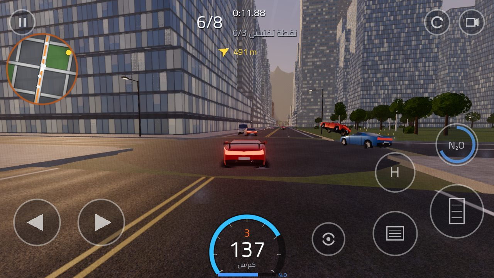
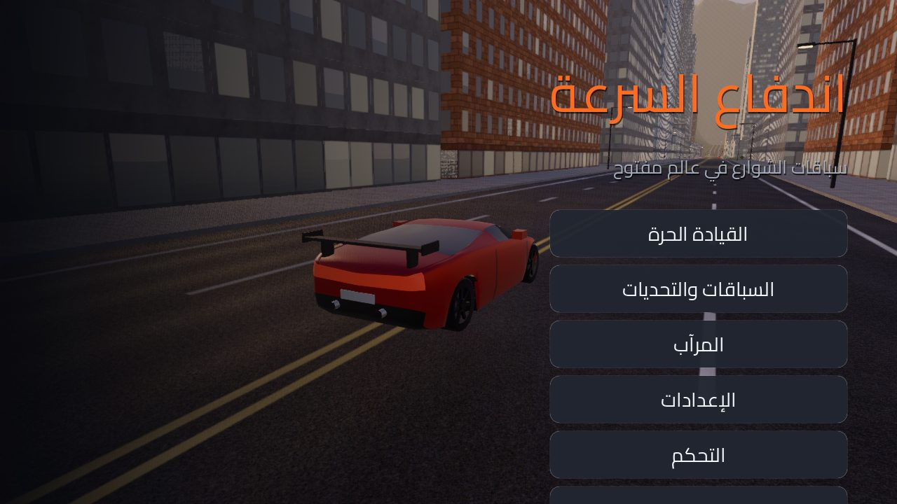
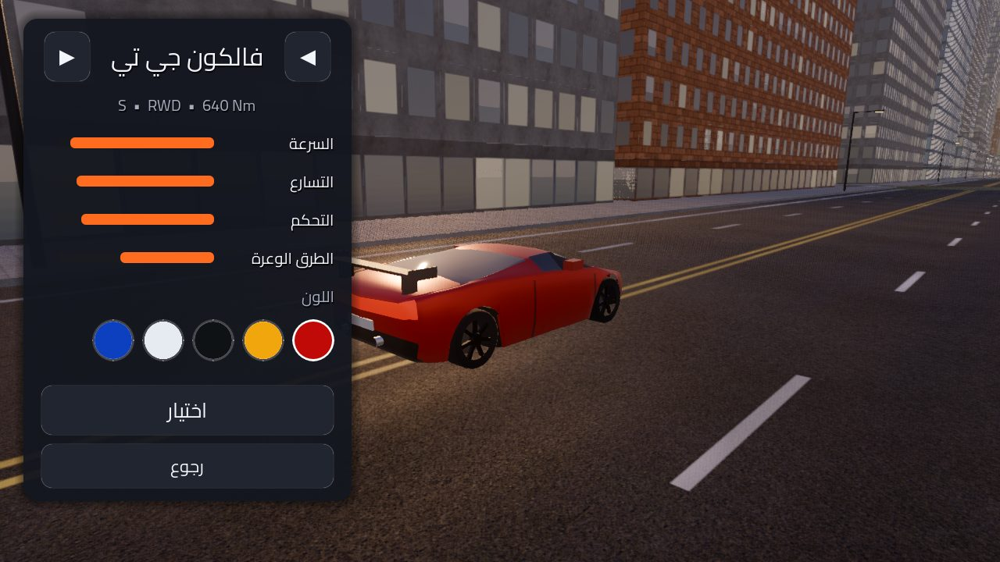
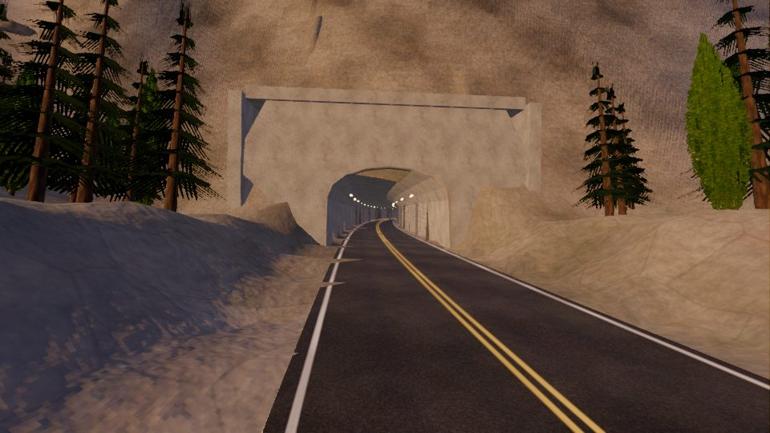
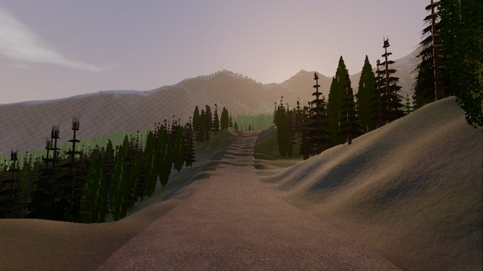
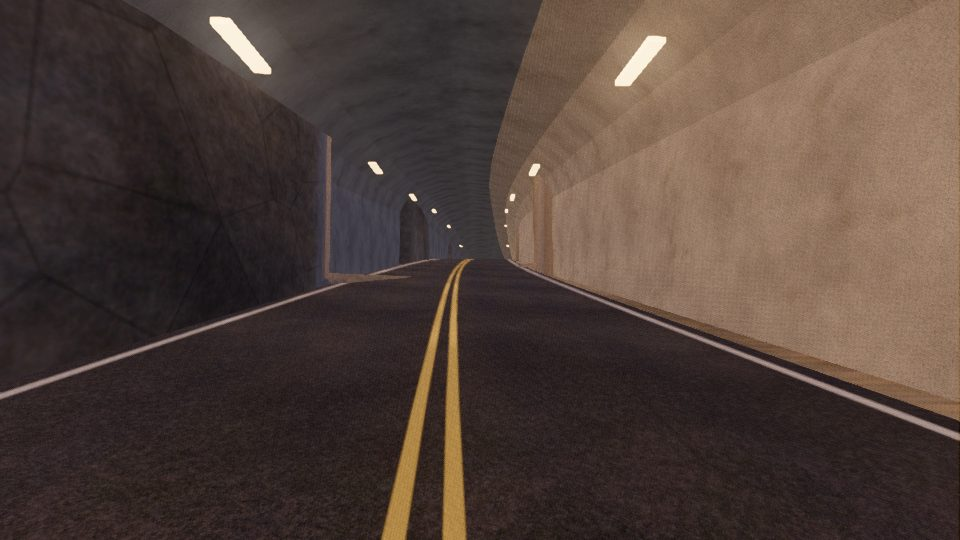
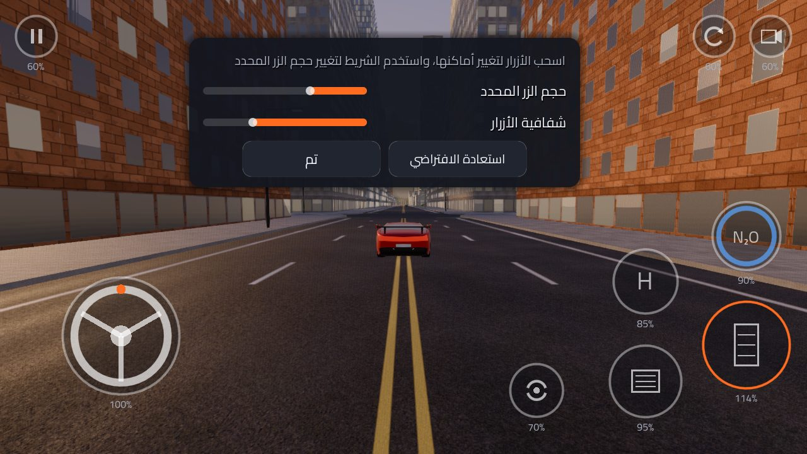
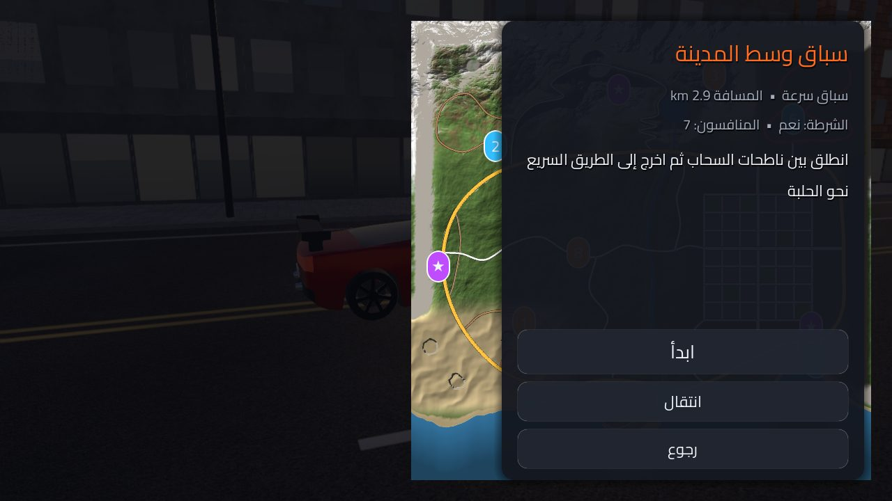
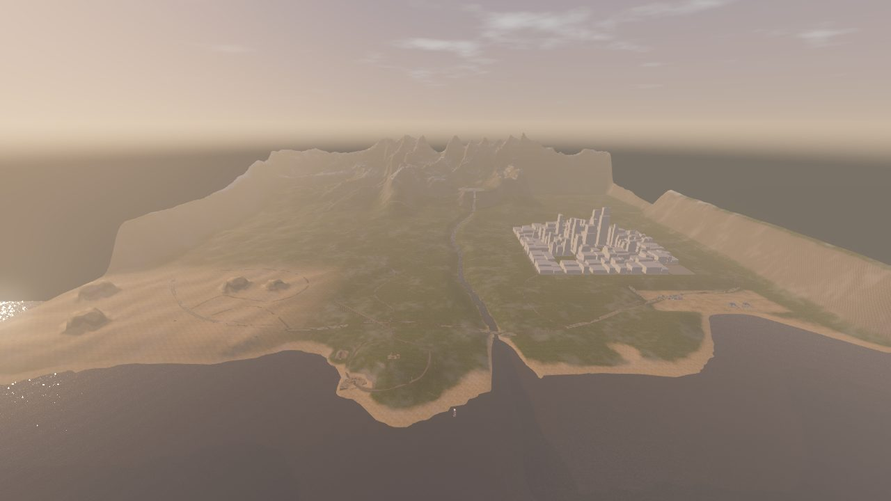

# Velocity Rush — اندفاع السرعة

لعبة سباقات شوارع في عالم مفتوح للهواتف، مبنية بمحرك **Godot 4.5**.
*An open‑world street‑racing game for phones, built with **Godot 4.5**.*



| | |
|---|---|
|  |  |
|  |  |
|  |  |
|  |  |

---

## العربية

### المزايا

**العالم المفتوح (4 × 4 كم)**
- جبال ثلجية مع ممر جبلي بمنعطفات حادة (دبوس شعر) ونفق تحت القمة.
- بحيرة جبلية وشلال ارتفاعه نحو 60 م ونهر يجري في وادٍ حتى البحر.
- غابة صنوبر كثيفة بطرق ترابية للرالي، وغابات وتلال ريفية.
- مدينة حديثة: ناطحات سحاب بواجهات زجاجية، شوارع شبكية، أرصفة، حدائق، موقع بناء، ومواقف سيارات.
- ميناء بحاويات ورافعات، وساحل وشواطئ.
- مدينة أثرية فوق تلة: معبد بأعمدة، مدرج روماني، قوس نصر، زقورة، مسلات، وقناة مياه قديمة. وكذلك منارة وقلعة وطواحين هواء.
- صحراء مفتوحة بكثبان رملية وهضاب.
- حلبة سباق مخصصة بمدرجات.
- أنواع طرق متعددة: طريق سريع دائري بأربعة مسارات وحاجز وسطي، جسور مرتفعة بدعامات، أنفاق مضاءة، طرق ريفية باتجاهين، شوارع ضيقة مرصوفة بالحجارة، وطرق ترابية، مع خطوط مرسومة على الطريق وحواجز حماية وأعمدة إنارة.
- منحدرات للقفز، وأشجار وصخور وصبار موزعة حسب كل منطقة.
- حركة مرور حية من سيارات مدنية (سيدان، هاتشباك، دفع رباعي، فان، بيك أب، تاكسي، شاحنة) تلتزم بالمسارات وتتبع السيارة التي أمامها وتطلق البوق. عند الاصطدام بها تتحول إلى جسم فيزيائي حقيقي.

**السباقات والتحديات**
- 8 سباقات في مناطق مختلفة، في كل منها **8 سيارات** (أنت + 7 منافسين بالذكاء الاصطناعي):
  - سباق وسط المدينة (سرعة)، الجائزة الكبرى (حلبة مخصصة، 3 لفات، بلا شرطة)، نزول الممر الجبلي، انطلاقة الساحل، رالي الصحراء المفتوح، رالي الغابة، حلبة المدينة الأثرية، والجولة الكبرى (9 كم).
- **نقاط تفتيش متباعدة** (600–1300 م) لإعطاء حرية في القيادة. **الطرق المختصرة مسموحة**، لكن عليك عبور كل نقطة تفتيش بالترتيب. نقاط التفتيش لا توضع أبداً داخل نطاق أي طريق مختصر، وإذا تجاوزت نقطة تفتيش تظهر رسالة "فاتتك نقطة التفتيش" مع سهم يوجهك إليها.
- أنماط المسارات: مسارات مخصصة للسباق (الحلبة)، ومسارات مفتوحة وواسعة بلا طرق (الصحراء، بوابات بعرض 70 م)، ومسارات تجمع بين الاثنين (الجولة الكبرى، الساحل).
- **النيترو**: كمية موحدة لكل سيارة في بداية كل سباق (نحو 7 ثوانٍ). عندما تنفد لا تعود حتى نهاية السباق. في القيادة الحرة يعاد شحنه تدريجياً.
- **مطاردة الشرطة** في سباقات الشوارع: مستويات حماوة (1–3)، وسيارات دورية بأضواء وصفارة تطارد المتسابقين وتصدمهم، وحواجز طرق في المستوى الثالث. يتم "القبض عليك" إذا حوصرت وأنت متوقف، ويمكن أن يقبض على المنافسين أيضاً. وتستطيع الإفلات بالابتعاد.
- تحديات: رادار السرعة، منطقة الانجراف (نقاط مع مضاعف)، وتحدي القفز. تُحفظ الأرقام القياسية.

**الفيزياء والقيادة**
- تعليق مستقل لكل عجلة (نوابض ومخمّدات وقضبان موازنة)، ونموذج إطارات من نوع Pacejka مع دائرة الاحتكاك وحساسية الحمل.
- انتقال وزن حقيقي، وكتلة وعزم قصور واقعيان (1350–1750 كغ)، فالسيارة ثقيلة وليست خفيفة.
- انجراف بفرملة اليد، وانزلاق خلفي عند الضغط الزائد في سيارات الدفع الخلفي، وانغلاق العجلات عند الفرملة القوية بدون ABS.
- التماسك يختلف حسب السطح: أسفلت، حجارة، حصى، تراب، عشب، رمل، ثلج. ويختلف أثر السطح أيضاً: دخان على الأسفلت وغبار على التراب.
- منحنى عزم للمحرك، وناقل حركة أوتوماتيكي، والرجوع للخلف، ومقاومة هوائية، وقوة ضغط سفلي.
- مساعدات قابلة للتعديل: ABS، التحكم بالجر، التحكم بالثبات، والتوجيه العكسي التلقائي.
- **التصوير البطيء السينمائي**: عندما تطير السيارة في الهواء، يتباطأ الزمن ويلتف المشهد حولها، وكذلك عند الحوادث القوية.
- **الحوادث**: انبعاج حقيقي في هيكل السيارة عند نقطة الاصطدام، وخدوش في الطلاء، وشرر، وحطام، واهتزاز للكاميرا والهاتف.

**الرسومات**
- كل شيء مولّد إجرائياً بدون أي ملفات خارجية: خامات PBR (أسفلت، صخر، رمل، ثلج، أحجار مرصوفة...)، وتضاريس بطبقات متعددة وإسقاط ثلاثي على المنحدرات، وماء بموجات ورغوة على الشواطئ، وشلال مع رذاذ، وسماء بغيوم متحركة، وضباب جوي، وظلال، وتوهج، وتنغيم لوني AgX.
- 12 هيكل سيارة مولّداً بـ"loft" من مقاطع منحنية، فيها زجاج وأعمدة وأقواس عجلات وأضواء وشبك أمامي ومرايا وجناح خلفي وعوادم، وعجلات بجنوط وأقراص فرامل، وطلاء بطبقة لامعة (clearcoat). وأضواء الفرامل تعمل فعلاً.
- أشجار ببطاقات أوراق شفافة تتحرك مع الرياح، ومستويين من التفاصيل (LOD) مع تحميل تدريجي للتضاريس بمستويات تفصيل مختلفة.
- الأصوات كلها مركّبة رقمياً: محرك (4/6/8/12 أسطوانة) يتغير مع عدد الدورات، وصرير إطارات، وحصى، ورياح، ونيترو، وصفارة شرطة، وتصادمات.

**تحكم مخصص للهاتف**
- 4 أنماط توجيه: أزرار، مقود دوّار، سحب أفقي، وإمالة الهاتف.
- أزرار: بنزين، فرامل/رجوع، فرملة يد، نيترو (مع حلقة تعرض الكمية المتبقية)، كاميرا، إعادة السيارة للطريق، نظر للخلف، وإيقاف مؤقت.
- **محرر تخطيط**: اسحب أي زر إلى المكان الذي تريده، وغيّر حجم كل زر على حدة، وتحكم بالشفافية والحجم العام والحساسية، واختر التسارع التلقائي. يُحفظ كل ذلك.
- يدعم اللمس المتعدد والاهتزاز. ويعمل أيضاً بلوحة المفاتيح ويد التحكم للتجربة على الحاسوب.
- واجهة كاملة بالعربية (من اليمين لليسار) والإنجليزية، مع خريطة مصغرة، وخريطة للعالم، ومرآب لاختيار السيارات والألوان، وإعدادات للرسومات.

### التشغيل
1. ثبّت **Godot 4.5** (أو أحدث من 4.x) ثم افتح مجلد المشروع (`project.godot`).
2. اضغط F5. أول استيراد للخامات يأخذ دقيقة أو اثنتين.
3. لوحة المفاتيح: `W/S` أو الأسهم للتسارع والفرملة، `A/D` للتوجيه، `Space` لفرملة اليد، `Shift` للنيترو، `C` للكاميرا، `R` لإعادة السيارة، `B` للنظر للخلف، `Esc` للإيقاف المؤقت.
   لعرض أزرار اللمس على الحاسوب: شغّل المشروع مع الوسيط `-- --touch`.

### التصدير إلى أندرويد
1. من Godot: *Editor ▸ Manage Export Templates* ثم نزّل القوالب.
2. اضبط Android SDK و JDK في *Editor Settings ▸ Export ▸ Android*.
3. *Project ▸ Export ▸ Android* ثم صدّر. الإعداد المرفق `export_presets.cfg` يضمّن ملفات العالم (`*.bin` و`*.json`) ويستعمل ضغط ETC2/ASTC للخامات (arm64).
4. على الهاتف تكون الجودة الافتراضية "متوسطة". يمكن تغيير الجودة ودقة العرض ومدى الرؤية وكثافة المرور من الإعدادات.

### إعادة توليد العالم والخامات (اختياري)
```bash
pip install numpy scipy pillow
python3 tools/gen_textures.py     # الخامات
python3 tools/world_builder.py    # التضاريس والطرق والسباقات والأشجار والمدينة
```
يمكنك تعديل الطرق والمناطق والسباقات من `tools/world_builder.py`، وكل شيء يُعاد توليده تلقائياً.

### ملاحظات صريحة
- كل الأشكال والخامات والأصوات مولّدة برمجياً، فلا توجد مجسمات ممسوحة ضوئياً أو أصول تجارية. السيارات منحنية ومفصّلة، لكنها ليست بمستوى ألعاب AAA مثل Need for Speed التي تعتمد على فرق فنية ضخمة. يمكن لاحقاً استبدال المجسمات بملفات glTF من عندك.
- الأداء جُرّب على عارض برمجي (بدون كرت شاشة). على الهواتف المتوسطة استخدم الجودة "منخفضة/متوسطة" ودقة عرض بين 0.7 و0.85.

---

## English

### Highlights
- **4×4 km world**: snowy mountains with a hairpin pass and summit tunnel, an alpine lake and ~60 m waterfall feeding a river to the sea, a pine forest with rally trails, countryside, a downtown with glass towers and a grid of streets, a harbour, beaches, an ancient hill‑top city (temple, amphitheatre, triumphal arch, ziggurat, obelisks, aqueduct), a lighthouse, a castle, windmills, an open desert with dunes and mesas, and a dedicated race circuit.
- **Road network**: a 4‑lane divided ring highway with median barriers, viaducts, and a tunnel; two‑way country roads; city avenues; a mountain pass; cobbled lanes; and dirt trails. It includes bridges with piers, lit tunnels with portals, guard rails, street lights, painted lane markings, and jump ramps.
- **Living traffic**: lane‑following civilian cars that keep their distance, honk, and turn into real physics bodies when you hit them.
- **8 races, 8 cars each** (you + 7 AI) across the map: sprints, circuits (including a closed track), an open desert rally with 70 m gates, and mixed routes. **Checkpoints are 600–1300 m apart. Shortcuts are allowed but never skip a checkpoint**, and if you miss one, the HUD warns you and points back to it. Every car starts with an **equal one‑time nitro allowance**.
- **Police pursuits** during street races: heat levels, interceptors with lightbars and sirens that ram, roadblocks at heat 3, a bust meter, and escaping. AI racers can get busted too.
- **Challenges**: speed trap, drift zone, and jump distance, with saved records.
- **Driving model**: raycast suspension with springs, dampers, and anti‑roll bars; a Pacejka‑style tyre model with a friction circle and load sensitivity; real mass and inertia; handbrake and power‑oversteer drifting; surface‑dependent grip; engine torque curve, auto gearbox, and reverse; drag and downforce; and optional assists. Airborne **cinematic slow motion** with an orbiting camera. **Crash deformation** dents the body mesh, with sparks, debris, and camera shake.
- **Everything is procedural**: PBR textures, car bodies (12 lofted styles), trees, buildings, ruins, water, sky, and all audio (engine synthesis by cylinder count).
- **Mobile controls**: buttons, rotating wheel, slider, or tilt steering, plus a **drag‑and‑resize layout editor**, opacity, size, sensitivity, auto‑accelerate, haptics, and multi‑touch. Full Arabic (RTL) and English UI.

### Run
Open the folder in **Godot 4.5+** and press F5. Keyboard: WASD/arrows, Space handbrake, Shift nitro, C camera, R reset, B look back, Esc pause. Add `-- --touch` to show the touch UI on desktop.

### Export to Android
Install the export templates, set up the Android SDK and JDK, then use the included **Android** preset (arm64, ETC2/ASTC, includes `assets/world/*.bin|*.json`).

### Regenerate content
`python3 tools/gen_textures.py` and `python3 tools/world_builder.py` (requires numpy, scipy, and pillow). Edit roads, regions, and events in `tools/world_builder.py`.

### Project layout
```
assets/            generated textures, baked world data, Cairo font (OFL)
scripts/core/      game state & settings, translations, sound synthesis, mesh helpers
scripts/world/     terrain streaming, roads, water, vegetation, city, ruins, sky
scripts/vehicle/   car physics, car model generator, FX, audio, chase camera, input
scripts/ai/        traffic, opponent AI, police AI and pursuit
scripts/race/      race routes and race manager (checkpoints, laps, challenges)
scripts/ui/        touch controls, HUD, minimap, menus
scripts/dev/       automated test harnesses (not exported)
shaders/           terrain, road, water, foliage, buildings, car paint, sky ...
tools/             offline generators (Python)
```

### Honest notes
All art is generated in code, with no scanned or commercial assets. The cars are curved and detailed, but they are not at the level of AAA studio art. For mid‑range phones, use Low/Medium quality with a render scale of 0.7–0.85.

The Cairo font is licensed under the SIL Open Font License (`assets/fonts/OFL.txt`).
