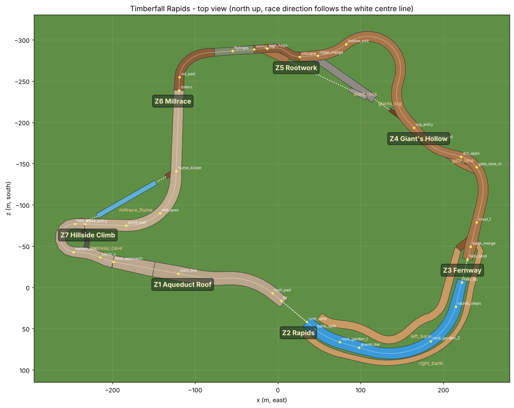
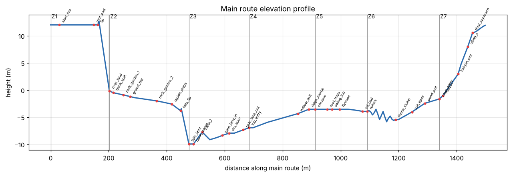

# TRACK_DESIGN — Timberfall Rapids

> Source of truth for geometry: `tools/track_timberfall.py` → `data/timberfall.json`.
> Diagrams regenerate with the script: `docs/track_map.png` (top view), `docs/track_profile.png` (elevation).

## 1. Summary

| | |
|---|---|
| Main-route length | ~1 505 m (closed loop, counter-clockwise from above) |
| Target lap (expert, main route) | ~45–50 s (to be measured, see §10) |
| Elevation range | +12.9 m (aqueduct roof lip) → −10 m (falls pool), ~23 m total |
| Width range | 9 m (ruin corridor) → 18 m (start grid) |
| Corner radii | 15–17 m (hairpin) to 150 m (roof sweeper); spirals 64→30 m and 46→21 m |
| Routes | main + 7 drivable branches (2 river banks, gate lane, Giant's Log + Ridge, Shelf Rock, Millrace Flume, Rootway Cave) |
| Race direction | Start on the aqueduct roof heading ESE → river (E then N) → forest (N then W) → ruins (W) → Millrace (S) → hillside climb (E) back onto the roof |

Coordinates: X east, Y up, Z south. All numbers below come from the authoring script.

## 2. Zones and how they chain together

| Zone | Identity / skill test | Key geometry | Feeds the next zone by… |
|---|---|---|---|
| **Z1 Aqueduct Roof** (start/finish) | Acceleration, first slide, jump commitment | 18 m wide grid → gentle left (R150, 14°) → long right sweeper (R78, 44°, banked −4°) → 4 m kicker lip (+0.7 m) | A 1–2 spark slide on the right sweeper + roof pad (inside line) gives reserve for a **lip-hop**; more hang time over the 12.9 m drop = bigger **air boost** on landing. Steering in the air chooses the river lane. |
| **Z2 Rapids** | Line choice between 3 lanes | River (14–15 m, CURRENT surface, flow 6.5 m/s): short left (R80) → straight → big left in two parts (R88 50°, spiral R78→66 42°) → narrowing chute (12 m) | Lane choice decides reserve vs. position entering Z3 (see §4). |
| **Lower Falls** | Momentum jump | River lip (+0.35 m kicker) → 6.5 m drop over a plunge pool | River-lane karts clear the pool only with speed; short = pool (SHALLOW_WATER, slow). |
| **Z3 Fernway** | Crest control, variable-radius corner, compound | Crest (+2.2/−1.4 m) → decreasing-radius left (R64→36 50°, then R36→30 40°, banked 5–6°) → short straight → right kink R52 34° | The right kink sets the entry angle for the hollow. Gate lane cuts the decreasing-radius left when the gate is open. |
| **Z4 Giant's Hollow** | Big shortcut decision + multi-apex corner | Right R46 62° → long multi-apex left R40 150° (banked 7°) around a 9 m-deep sinkhole → right R60 36° | Giant's Log needs carried speed (from Z2 left bank / pads) or a lip-hop. From the Ridge, the Shelf Rock jump (stage 2) needs Overdrive-level speed. |
| **Z5 Rootwork** | Technical precision, timing | Chicane R19 ±48° → root hops → 9 m ruin corridor (swinging log, 3 flytraps) → decreasing-radius left R46→21 84° | Exit quality decides whether you hit the **Overdrive pad** (placed on the inside exit line). |
| **Z6 Millrace** (climax) | Speed management, momentum shortcut | Downhill rollers 98 m (0.9 m waves) → kicker → long right around the mill pond R58 46°+44° (two apexes) | Overdrive from the pad (kept alive with slides on the rollers) is what makes the **Flume** reachable. The flume lands you at the hairpin entry — and at the hidden cave mouth. |
| **Z7 Hillside Climb** | Hairpin technique, overtaking | Climbing hairpin L R17 178° (banked 9°) → short straight → climbing S (R60 22°/16°) → parapet approach onto the roof | Hook-turn or cave determines exit speed onto the roof straight → start of the next lap's roof sweeper. |

### Chain examples (the "A → B → C → D" principle)
1. **Left bank (build reserve) → Lower Falls exit → Fernway crest → Giant's Log gap.** The log gap (22 m, landing 3.5 m lower) needs ≥ ~26.8 m/s at the lip (above base top speed 26) **or** a lip-hop. Reserve built on the left bank's S-bends is what lets a non-hopping driver make it.
2. **Rootwork exit line → Overdrive pad → rollers (slide-chain to keep Overdrive) → Flume kicker** (needs ~30.5 m/s, i.e. tier 2) → **flume lands at the hairpin** → **hook turn or Rootway Cave**.
3. **Roof sweeper slide + roof pad → lip-hop over the 12.9 m drop** → air boost → enter the river lane fast → clear the Lower Falls pool.

## 3. Corner catalogue

| Corner | Type | Geometry | Solutions (beginner → expert) |
|---|---|---|---|
| Roof sweeper | Wide long | R78, 44°, bank −4° | Steer through → 1–2 spark slide → slide + roof pad on the inside |
| Rapids big bend | Wide, tightening | R88 → R78→66 | Ride the current in the middle → weave the rock garden → slide on the bank lanes |
| Fernway spiral | Decreasing radius | R64→36 then R36→30 | Lift / brake → early slide to set the angle → late apex for the right kink |
| Fernway kink + hollow entry | Compound (L→R→L) | R30 → R52 → R46 | Exit angle of each sets the next; designed as one sequence |
| Hollow wrap | Multi-apex | R40, 150°, bank 7° | Two-apex line hugging both inside points or one wide carried-speed line |
| Rootwork chicane | Tight S | R19 ±48° | Steer → hop-slide switch → straight-line it over the roots |
| Ruins exit | Decreasing radius | R46→21, 84° | Must be early to hit the Overdrive pad on the inside |
| Mill sweeper | Long two-apex | R58 46° + 44° | Wide carried line vs. inside line; flume skips it |
| Climbing hairpin | Hairpin | R17, 178°, bank 9° | Brake + steer → slide → **hook turn** (pull back while sliding) + hook boost → cave skips it |
| Climbing S | Overtaking | R60 22° / 16° | Flat out with a short slide chain onto the roof |

## 4. Lines through the river (Z2)

| Lane | Surface | Length (approx.) | Pros | Cons |
|---|---|---|---|---|
| **River (centre)** | CURRENT: +flow on top of a 0.92× cap, low grip | shortest (~250 m) | Current pushes you above normal max; leads straight into the falls jump | 2 rock gardens + rapids; drifting charges at 0.6× (little reserve); low grip; falling short of the pool costs time |
| **Right bank** | DIRT, 6.5–7.5 m wide | longer (outside of the big bend) | Safe, predictable; rocky descent beside the falls | Narrow, river on one side, trees on the other; little room to slide |
| **Left bank** | DIRT, 9.5 m, weaving S-bends + 2 crate rows + pad | longest | Best place to chain slides & build reserve; extra crates/amber | Distance; boardwalk descent |

The intended outcome: river = fastest arrival, low reserve; left bank = later arrival, high reserve (unlocks Giant's Log without a hop); right bank = safe middle. Which is best depends on speed, reserve and skill — to be confirmed by the route timing tests (§10).

## 5. Shortcuts

| # | Name | Type | Entry requirement | Est. saving* | Failure | Visual cues |
|---|---|---|---|---|---|---|
| S1 | **River lane** | Line / distance | none | ~1 s vs banks | rocks, slow pool | open water, foam lines mark gaps |
| S2 | **Woodcutter's Gate lane** | Interaction | gate broken (Overdrive ram or any projectile); reforms after 18 s | ~0.8 s | bounce off the gate | rope-tied logs visible from the crest; chevrons on the spiral |
| S3 | **Giant's Log** | Precision jump / momentum | ≥ ~26.8 m/s at the lip, or lip-hop | ~2 s | fall into the Hollow (drivable, ~2.5 s lost) | huge fallen trunk visible from Z3 crest, fungus "steps", amber line on top |
| S4 | **Shelf Rock** (from the Ridge) | Multi-stage (needs S3) | tier 2 / ≥ 29 m/s | ~1.5 s more | short landing / into the chicane | slab ramp on the ridge's left edge, landing pad visible across the gap |
| S5 | **Millrace Flume** | Momentum + high risk | ≥ ~30.5 m/s (Overdrive) at the kicker | ~1.5 s, and lines up the cave | fall short into the mill pond / trestles | wooden kicker by the roller exit, water wheel landmark, amber in the flume |
| S6 | **Rootway Cave** | Hidden environmental | none (find it) | ~1 s if clean | stalagmites (alternating), narrow 5.5 m | vine curtain, fireflies, glowing crystals, chevrons point away (it's on the hairpin's *inside* wall) |
| S7 | **Lip-hop / air lines** | Precision | hop timing at lips | air boosts | over-rotation → bad landing −18 % speed | every lip has a short kicker |

*Savings are design estimates from route lengths; the `routes` test suite measures them (§10).

## 6. Jumps and heights
- Tunnel Leap: 12.9 m drop, 36 m gap, 0.7 m kicker. Hang ≈ 1.0 s (no hop) → air boost; lip-hop adds ≈ 0.35 s.
- Lower Falls: 6.5 m over a 13 m pool; clear it with speed.
- Giant's Log: 4.4 m lip, 22 m gap, landing 3.5 m lower.
- Shelf Rock: 2.8 m lip → into the Rootwork corridor.
- Flume kicker: +2.4 m up into the flume (needs speed); flume drop ≈ 4 m onto the hairpin approach.
- Crest hops (Fernway) and Millrace rollers (0.9 m, 24.5 m wavelength) launch the kart briefly at high speed; landing on the downslope keeps speed.

## 7. Surfaces map
Roof/approach/mill/climb: ROAD (cobbles). Fernway/Hollow/Rootwork: DIRT with roots. Ruin corridor: MOSS. River & flume: CURRENT. Pools: SHALLOW_WATER. River banks' wet edges: SAND. Off-road: GRASS (slow, drains reserve ×1.8). Log/boardwalk/kicker: WOOD. Ridge/cave/descent: ROCK.

## 8. Obstacles (each is a readable test)
| Obstacle | Where | Test |
|---|---|---|
| River boulders (staggered rows, ≥ 3 m gaps) | Rock gardens 1 & 2, rapids | line choice at speed |
| Swinging log (period 3.4 s) | ruin corridor | timing |
| 3 Flytraps (alternate sides, 0.85 s glowing telegraph) | ruin corridor | timing + line |
| Stalagmites (alternating) | cave | precision |
| Moss Arch legs | outside the banks | framing only |
| Woodcutter's Gate | gate lane | interaction |

## 9. Landmarks (spatial memory)
Aqueduct + portal (Z1), Moss Arch over the river (Z2), Lower Falls (Z2/3), Elder Tree (infield, visible from Z3/Z4), Giant's Log (Z4), Guardian Owl statue with glowing eyes (Z5), water-wheel mill & flume (Z6), glowing cave crystals (Z7), Skyveil Falls & ruined watchtower (background).

## 10. Validation status
**Not yet executed** — the Godot binary could not be downloaded in the build session (see NEXT_SESSION.md). Ready-to-run suites:
- `tools/build.sh test track` — geometry continuity on every route, grid validity, width & radius variety.
- `tools/build.sh test routes` — the same Expert AI forced through each route (baseline / left / right / log / log+shelf / cave / flume / all) → lap times, boost time, Overdrive time, impacts. Use it to balance §4–§5.
- `tools/build.sh test ai` — full 8-kart fields (Normal, Expert) must finish.
