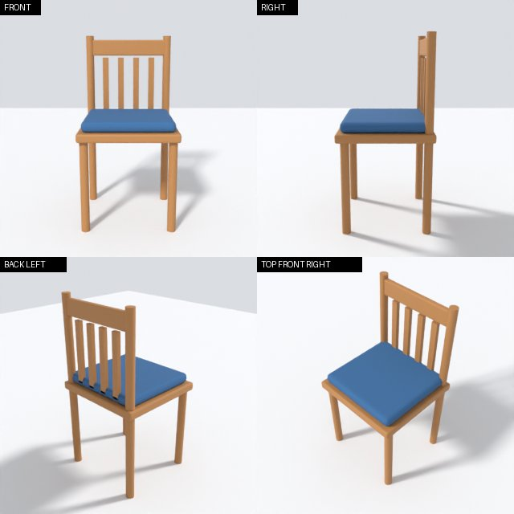
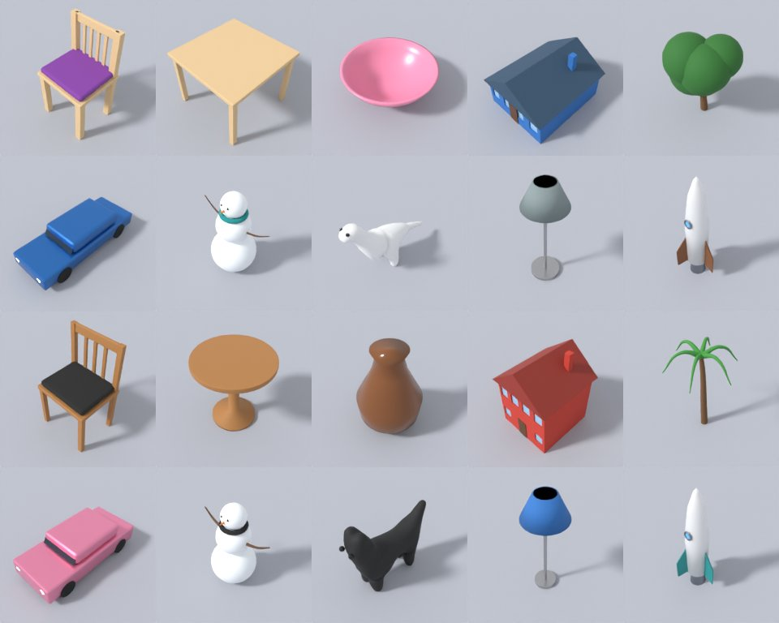

# مُجسَّم — Mujassam

**نموذج ذكاء اصطناعي عصبي هجين متخصص في صناعة المجسمات ثلاثية الأبعاد لـ Blender**
نص أو صورة ← مجسم قابل للتعديل (`.glb` / `.blend` / سكربت بايثون لـ Blender)، مع **رؤية ذاتية**:
النموذج يرى صوره المرسومة لعمله من 4 زوايا، ينتقدها، يصلحها، ويكرر حتى ينجح في تقييمه الذاتي.



---

## 1) المواصفات مقابل طلبك

| طلبك | ما تم بناؤه |
|---|---|
| 4–5 مليار معامل | الملف الافتراضي `mujassam-4.9b` = **4.90B** (عقل Qwen3-VL-4B بحجم 4.44B + TripoSR بحجم 0.42B + U²-Net بحجم 0.04B). يُقاس العدد الفعلي عند التحميل ويُقارن بالحد تلقائياً (`check_budget`) |
| مضغوط وسريع | العقل يعمل بدقة **4-bit NF4** مع إبقاء مرمّز الرؤية بدقة 16-bit (≈3.5 GB ذاكرة GPU بدل ≈9 GB). يخرج النموذج JSON مختصراً بدل كود طويل (توكنات أقل = أسرع). يدعم أيضاً تصدير **GGUF Q4** لـ llama.cpp. ثلاثة أوضاع: `fast` / `balanced` / `quality` |
| رؤية بصرية وفنية، كل أنواع المجسمات | 14 نوعاً من الأشكال: صناديق، أسطوانات، **lathe** (مزهريات، أعمدة)، **skin** (كائنات حية وشخصيات)، **tube** (أغصان، أنابيب، ذيول)، **extrude** (أشكال مقطوعة، أسقف)، نصوص ثلاثية الأبعاد، عمليات Boolean (نوافذ، ثقوب)، Mirror، Array، Bevel، ومواد PBR |
| الالتزام بالتوجيهات | وحدة توجيه (router) تستخرج **قائمة تحقق** من كل متطلب في طلبك (العدد، اللون، الأسلوب...). المُقيّم يتحقق من كل بند ويعطي «الالتزام» وزناً مضاعفاً |
| يرى عمله ويقيّمه ويطوّره | حلقة: بناء ← تصيير 4 زوايا ← فحوص هندسية آلية (أجزاء طائرة، حجم غير واقعي، أخطاء) ← نقد بصري ← تعديلات صغيرة دقيقة ← إعادة بناء. يحتفظ بأفضل نسخة |
| تحويل الصور إلى مجسمات | مسار صورة ← تحليل بصري ← **TripoSR** (شبكة عصبية لإعادة البناء) **و/أو** بناء إجرائي من الصورة، ثم يقارن المُقيّم النتيجتين بالصورة المرجعية ويختار الأفضل |

## 2) البنية

```
                    ┌──────────────── العقل: Qwen3-VL-4B (4-bit) ────────────────┐
 نص عربي/إنجليزي ──►│ router ─► planner ×N ──► مواصفة JSON (لغة المجسمات MSS)    │
 صورة ─────────────►│ analyst ─┘                    │                            │
                    │                               ▼                            │
                    │                 Blender (بناء + تصيير 4 زوايا + فحوص)       │
                    │                               │                            │
                    │            critic ◄── يرى الصور + تقرير تقني + المواصفة      │
                    │              │ تعديلات (patch) أو إعادة تخطيط               │
                    │              └──────────► حلقة حتى الدرجة ≥ 8.6            │
                    └────────────────────────────────────────────────────────────┘
 صورة ─► U²-Net (إزالة الخلفية) ─► TripoSR ─► شبكة مضلعات ─► تنظيف في Blender ─► نفس الحلقة
                                                          ▼
                                     model.glb + model.blend + model_build.py + preview.png
```

**لماذا «لغة مجسمات» بدل كتابة كود Blender مباشرة؟** نموذج بحجم 4B يخطئ كثيراً في كود `bpy` الخام
(دوال غير موجودة، أخطاء سياق). لغة MSS (`mujassam/dsl/schema.py`) مختصرة ومُتحقَّق منها ومُصلَحة آلياً،
وكل خطأ يصبح تعديلاً صغيراً في JSON يستطيع المُقيّم إصلاحه. ومع ذلك يوجد وضع «كود حر» آمن
(`compile_freeform`) يمر عبر فحص أمني (`blender/sandbox.py`) يمنع الوصول للملفات والشبكة.

| الملف | الوظيفة |
|---|---|
| `mujassam/model.py` | `MujassamModel`: التحميل، عدّ المعاملات، الضغط، الحفظ كحزمة واحدة |
| `mujassam/pipeline.py` | حلقة التوليد ← الرؤية ← النقد ← الإصلاح |
| `mujassam/brain/` | العقل (Qwen3-VL عبر transformers، أو أي خادم OpenAI-compatible مثل llama.cpp) والتعليمات |
| `mujassam/dsl/` | لغة المجسمات: التحقق والإصلاح الآلي والتعديلات |
| `mujassam/blender/` | مكتبة Blender الداخلية، المُترجم، المشغّل المعزول، الفحص الأمني |
| `mujassam/recon/` | صورة ← مجسم: TripoSR (افتراضي) و TRELLIS.2 (اختياري للجودة القصوى) |
| `mujassam/critic/` | الفحوص الهندسية والمُقيّم البصري |
| `mujassam/server.py` | خادم API لتطبيق الهاتف |
| `training/` | بيانات تدريب اصطناعية، تدريب LoRA، تحسين ذاتي |
| `notebooks/Mujassam_Colab.ipynb` | كل شيء على Colab وحفظ النموذج في Google Drive |

## 3) التشغيل — الطريقة الأسهل (Colab + Google Drive)

1. افتح `notebooks/Mujassam_Colab.ipynb` في Google Colab (File → Upload notebook، أو من GitHub).
2. اختر **T4 GPU** وشغّل الخلايا بالترتيب.
3. الخلية 9 تحفظ الحزمة الكاملة (≈3.5–4 GB) في `MyDrive/Mujassam/mujassam-4.9b`.
4. في المرات القادمة يُحمَّل النموذج مباشرة من Drive.

## 4) الاستخدام من بايثون

```python
from mujassam import MujassamModel

m = MujassamModel.from_pretrained("/content/drive/MyDrive/Mujassam/mujassam-4.9b")   # أو "mujassam-4.9b"
print(m.check_budget()[1])            # 4.90 B parameters (within budget 4.0-5.0 B)

r = m.generate_from_text("قلعة صغيرة بأربعة أبراج وجسر متحرك", out_dir="out", preset="quality")
print(r.score, r.files["glb"], r.files["blend"])

r = m.generate_from_image("photo.jpg", prompt="بأسلوب كرتوني", out_dir="out_img")
```

سطر الأوامر:

```bash
mujassam text "مصباح طاولة عصري بغطاء أصفر" --preset balanced --out out
mujassam image photo.jpg --out out_img
mujassam build examples/specs/chair.json --out chair      # بدون ذكاء اصطناعي: مواصفة ← Blender
mujassam info                                             # الملفات الشخصية وعدد المعاملات
```

المخرجات في كل مرة: `*.glb` (للهاتف والويب والألعاب)، `*.blend` (مع المعدِّلات قابلة للتعديل)،
`*_build.py` (سكربت مستقل يعيد البناء داخل Blender)، `*_spec.json`، `*_preview.png`، و`report.json`
(كل المحاولات ودرجاتها وملاحظات المُقيّم).

## 5) الربط بتطبيقك على الهاتف

الهاتف لا يستطيع تشغيل نموذج 4.9B مع Blender بسرعة معقولة، لذلك يعمل النموذج على GPU (Colab أو خادم)
ويتصل به التطبيق عبر API:

```
POST /v1/text-to-3d     {"prompt": "...", "preset": "balanced"}        ← {"id": "...", "status": "queued"}
POST /v1/image-to-3d    multipart: image, prompt, preset
GET  /v1/jobs/{id}      ← status / score / files
GET  /v1/jobs/{id}/files/<name>.glb      ← تحميل المجسم واستيراده في التطبيق
```

الخلية 11 في الدفتر تشغّل الخادم وتعطيك رابطاً عاماً ومفتاح API. صيغة `.glb` تُستورد مباشرة في
Blender وفي أغلب تطبيقات النمذجة على الهاتف. إذا كان تطبيقك يشغّل سكربتات بايثون فيمكنه أيضاً تشغيل
`*_build.py` لإعادة بناء المجسم بمعدِّلات قابلة للتعديل.

## 6) الضغط والسرعة

| وضع العقل | ذاكرة العقل (تقريباً) | ملاحظات |
|---|---|---|
| bf16 كامل | ~9 GB | أعلى دقة |
| **NF4 (افتراضي)** | **~3.5 GB** | مرمّز الرؤية والتضمينات بدقة 16-bit |
| GGUF Q4_K_M (llama.cpp) | ~3 GB، يعمل على CPU أيضاً | `--brain-backend openai --openai-url http://127.0.0.1:8080/v1` |

يُضاف إليها TripoSR ‏(~1.7 GB أوزان، وذروة ~6 GB أثناء تحويل صورة). المجموع يتسع في T4 ‏(16 GB).

تصدير GGUF (يتطلب نسخة llama.cpp تدعم Qwen3-VL):

```bash
python llama.cpp/convert_hf_to_gguf.py brain_merged --outfile brain-f16.gguf
python llama.cpp/convert_hf_to_gguf.py brain_merged --mmproj --outfile mmproj.gguf
llama.cpp/build/bin/llama-quantize brain-f16.gguf brain-Q4_K_M.gguf Q4_K_M
llama.cpp/build/bin/llama-server -m brain-Q4_K_M.gguf --mmproj mmproj.gguf --port 8080
```

(`brain_merged` = `m.save_pretrained(dir, merge_lora=True)` من نسخة غير مضغوطة `brain_quantization="none"`.)

## 7) التدريب التخصصي والتحسين الذاتي

1. **بيانات اصطناعية بلا تعليم بشري** (`training/synth_data.py`): 10 مولّدات إجرائية (كراسي، طاولات،
   أوانٍ، منازل، أشجار، سيارات، شخصيات، كائنات، مصابيح، صواريخ) بأبعاد وألوان عشوائية، وأوصاف بالعربية
   والإنجليزية. كل مجسم يُبنى ويُصيَّر في Blender ويُحوَّل إلى أمثلة لكل مهام العقل. **الحيلة الأساسية:**
   نُفسد مجسماً سليماً بطريقة معروفة (نرفع جزءاً ليطفو، نحذف جزءاً، نغيّر لوناً أو مقياساً) فيصبح الهدف
   هو التعديل الذي يصلحه بالضبط، فيتعلم العقل أن **يرى** أخطاءه ويصلحها.

   

2. **QLoRA** (`training/sft_lora.py`): يتسع على T4 مجاني.
3. **التحسين الذاتي** (`training/self_improve.py`): النموذج يولّد وينتقد ويصلح، ونحتفظ بأفضل أعماله
   (درجة ≥ 8) كبيانات تدريب جديدة + أزواج تفضيل (DPO)، ثم نعيد التدريب. تتكرر الدورة.

## 8) الملفات الشخصية

| الملف | المعاملات | العتاد | الاستخدام |
|---|---|---|---|
| **`mujassam-4.9b`** (افتراضي) | 4.90B | GPU ‏6–16 GB | ما طلبته |
| `mujassam-lite-2.6b` | 2.59B | GPU ‏4–6 GB | أسرع، جودة أقل |
| `mujassam-pro-8.4b` | 8.44B | GPU ‏24 GB+ | TRELLIS.2 لأفضل تحويل صورة ← مجسم (خارج حد 4–5B) |

## 9) حدود يجب أن تعرفها (بصراحة)

* أوزان الشبكات العصبية **مُدرَّبة مسبقاً** من مشاريع مفتوحة المصدر (Qwen3-VL من Alibaba، TripoSR من
  Stability AI و Tripo AI، U²-Net). الجديد في مُجسَّم هو طريقة الدمج: لغة المجسمات، حلقة الرؤية والنقد
  الذاتي، الفحوص الهندسية، خط بيانات التدريب الاصطناعية، التدريب التخصصي، الضغط، والخادم.
  تدريب نموذج 4–5B من الصفر يحتاج آلاف ساعات GPU وملايين المجسمات، وهذا غير عملي.
* **قبل تشغيل التدريب التخصصي** (الخلية 10) يعمل العقل بالتعليمات وحدها: جيد للأثاث والمباني والأدوات
  والأشياء المصممة، وأضعف في الكائنات العضوية المعقدة من النص وحده. للكائنات العضوية تعطي الصورة
  المرجعية (مسار TripoSR) نتائج أفضل بكثير.
* TripoSR يعطي ألوان رؤوس (vertex colors) وليس خامات PBR كاملة. للجودة القصوى استخدم `mujassam-pro-8.4b`.
* كل مكونات الحزمة بتراخيص تسمح بالاستخدام التجاري: Qwen3-VL ‏(Apache-2.0)، TripoSR ‏(MIT)،
  U²-Net ‏(Apache-2.0)، TRELLIS.2 ‏(MIT). احتفظ بملفات التراخيص عند المشاركة.

## 10) الاختبارات

```bash
pip install -e ".[dev]" bpy        # bpy = Blender كوحدة بايثون (أو اضبط MUJASSAM_BLENDER=/path/to/blender)
pytest -q
```

تغطي الاختبارات (44 اختباراً): إصلاح المواصفات، التعديلات، استخراج JSON من ردود النموذج، الفحص الأمني
للكود، البناء الفعلي في Blender لكل أنواع الأشكال، كشف الأجزاء الطائرة، حلقة النقد الذاتي كاملة (نص وصورة)
بعقل محاكى، خادم API، وأيضاً المسارات الحقيقية لمكتبة transformers باستخدام نسخة **مصغّرة عشوائية** من
Qwen3-VL تُبنى محلياً: المحادثة مع الصور، مُجمِّع بيانات التدريب، سكربت تدريب LoRA كاملاً، وحفظ/تحميل
الحزمة مع LoRA (مدمج وغير مدمج). هذه الاختبارات تتحقق من صحة الربط البرمجي، لا من جودة النموذج الحقيقي.
